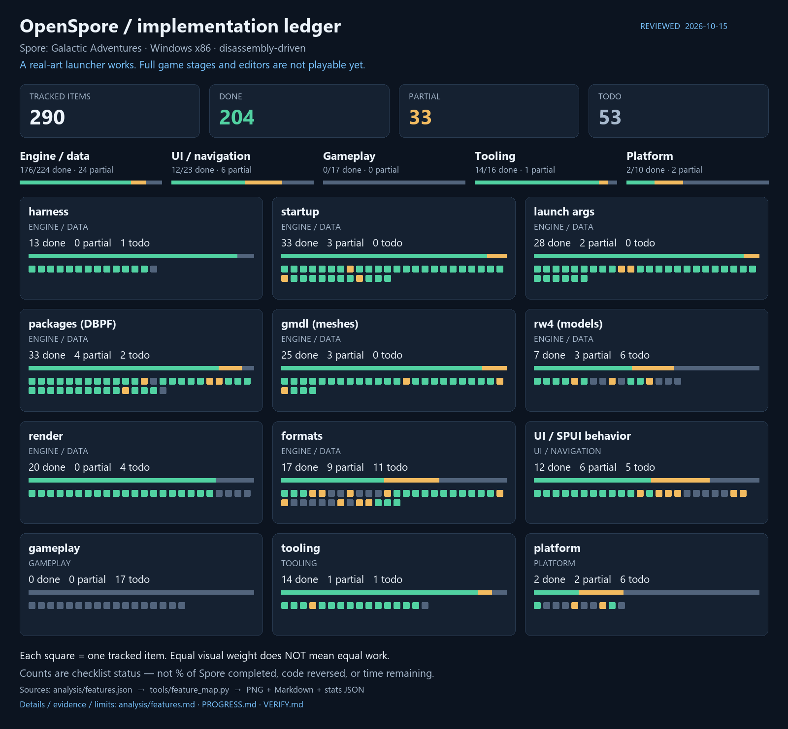

# PROGRESS — current capabilities and validation

Reviewed **2026-10-15**. This is a runtime/status summary, not a completion percentage.
Detailed counts and the dashboard are generated from [features.json](analysis/features.json):
[full ledger](analysis/features.md) · [stats JSON](analysis/features_stats.json).



## Main → playable

```text
entry / CRT / WinMain → boot → packages / config → states → real-art launcher → visible selection
                                                                            ↓
                                                     CreatureEditor state entered
                                                     editor & game simulation NOT implemented
```

| Layer | Current result | Boundary |
|---|---|---|
| Boot / platform | MSVC Win32 Debug, warning-free; window/D3D9/console/log/capture | x64 untested; not release-ready |
| Packages | 57 DBPF files / 150,945 records; index invariants pass; RefPack implemented | full resource priority and write/repack open |
| Locale | 265 distinct tables / 23,933 distinct table-key texts in the recorded en-us corpus | original text/font pipeline incomplete |
| SPUI framing | 748/748 exact EOF in Python/C++; code 19 references, code 20 nested structs | framing is not full widget behavior |
| SPUI graph | 93,726 objects / 22,384 windows / 20,659 child links; shared ancestor Clip for paint/picking | dynamic Z/layout still host policy |
| Drawables | atlas UV/logical sizes; None-tiling ImageDrawable; non-tileable Standard/Radio state slices | tiling, shadow/outline, dialog pieces open |
| Input | visible `(311,550)` -> CreatureEditor `0x022D9E01` | control/state bridge, not original command bus |
| GGE primary UI | Main -> GalaxyGameEntry presents the GA-default `GlobalUIGGE-9` | sparse serialized visibility; galaxy scene, zoom panels, properties/controller events not implemented |
| GGE Intro gate | phase-6/movie-idle predicate and DBCheck notification/one-shot requests modelled and tested | runtime explicitly waits for unimplemented MoviePlayer observation; no actual DBCheck/state10 transition |
| DBCheck executor | recovered bypass/dialog/callback side-effect ordering with explicit backend; actual dialog corpus/root verified | controlled backend only; live content-manager/WinProc adapter missing; Play Spore scene not run |
| Catalogue projection | saved/new fields, indices, raw positions, stages, image fallback and two-word save-header predicate | typed controlled inputs only; stars.db reader/candidate generation/live catalogue not implemented |
| stars.db serializer subset | bounded frames, six metadata fields, variable-width wire references/grid and 14 StarRecord fields | wire-only modes do not resolve identities; separate context subset below; no real-save validation, producer or runtime integration |
| stars.db context subset | explicit decoded index/class streams, envelope CRC and class-scoped token lookup into StarRecord fields | no full graph/fixups or real-save corpus; not runtime catalogue availability |
| stars.db physical subset | one explicit read-only DBPF 3.0, exact root/index/class keys, raw/RefPack decode into structural readers | constructed fixtures only; other versions, real-save compatibility, fixups and live producer unverified |
| StarRecord post-load subset | corrected empty/BAD_DATA equality + ordered generation/setter requirements, profile Unknown/Found/Missing | no canonical-name/cache-purpose inference; real generation/profile/notification services and live producer missing |
| Save file-header subset | first root frame, actual major/minor/mode/timestamp/planet key; unsigned major>=33 probe | explicit DBPF only; map/snapshot/root tail opaque, no save discovery/real-save corpus; planet-name subset below |
| PlanetRecord / saved adapter | nested prefixes/six fields, counted ResourceKeys/filtering and first selected name → typed saved metadata | controlled generation/terrain/header observations; no discovery, real corpus, candidate producer or GGE scene |
| GGE star presentation calculations | explicit-camera projection, root centering/saved clamp/4px deadband, stage/caption/flag plan; real star-layout controls bound | no camera creation/per-entry mounting/plugins/effects/runtime scene; current screen unchanged |
| GGE owned host instances | separate window graphs per entry, explicit object-index overlays, recomputed geometry/Clip/pixel picking and shared renderer hook | native mount/phase1/plugins/listeners/camera/scene absent; no automatic GGE instantiation or changed screen |
| GGE phase-1 binding plan | ordered control/image/locale/profile/selected-star requirements; structural statuses and explicit duplicate choices | no native operations/interface queries/resource loads or phase latch; native return1 is not a readiness check |
| GGE image application subset | explicit DBPF PNG provider → decoded immutable pixels → plain ImageDrawable override → shared painter; atlas/instance isolation | one resolved image request only; Animated Icon uses separate static-selector API; full phase lifecycle/native callbacks/scene not implemented; GGE screen unchanged |
| GGE static Animated Icon | explicit window index → separate frame state → atlas-composed quad/shared painter; actual five-frame descriptors | AutoPlay=false/positive grid only; no native normalization/playback/automatic GGE caller; QI0106F146 returns object, caller takes+20C |
| Models | real gmdl/raster subset and textured diagnostic model gallery | full RW4, animation, materials and game world open |
| Gameplay | mode registration table recovered | no playable stage or implemented editor |

## Repeatable regressions

| Check | Recorded result | Command / evidence |
|---|---|---|
| Build | 0 compiler warnings/errors, x86 Debug | `cmake --build build --config Debug --target OpenSpore spui_verify pkg_lifetime_verify overlay_clip_verify` |
| Boot | 10/10 markers | `-w -devDirs`, newest section of `OpenSpore.log` |
| Independent SPUI parse | 748/748 through EOF | `python tools/spui_objects.py --parse --all ...` |
| C++ corpus + malformed inputs | 748 matches; 486 rejected atomically | `spui_verify <fixtures>` |
| Drawable subset | atlas, standard/radio states, fixed scale, three alignments, unsupported modes | same `spui_verify` target |
| Package lifetime | 544 open/read/destruct cycles at CRT limit 512 | `pkg_lifetime_verify <package>` |
| Ancestor Clip | nested/empty/boundary geometry, shared picking; D3D9 quad/text/state pixel readback PASS | `spui_verify <fixtures>` and `overlay_clip_verify <new-capture.bmp>` |
| Index invariants | 57 packages / 150,945 records / 0 violations | `python tools/pkg_kinds.py` |
| Live launcher | real atlas-aware art, exit 0, aborts/asserts 0 | [capture](analysis/shots/spui_e3launch_uv.png) |
| Visible transition | CreatureEditor entered, exit 0 | `-state:DevLauncher -quitAfter 18 -exec spui:-click,311,550` |
| GGE UI binding | exact mode/name/hash test; Main -> GGE capture, exit 0 | `mode_ui_verify`; [static/live boundary](analysis/galaxy-entry.md) |
| GGE post-title guard | 2040 controlled-signal checks; no time-based auto-completion | `gge_intro_verify`; [Intro evidence/limits](analysis/gge-intro.md) |
| DBCheck branches | real 101-object/24-window dialog fixture; Unknown vs absent, failure/callback/cleanup and Intro integration PASS | `gge_dbcheck_verify <fixtures>`; [state-2/DBCheck evidence](analysis/gge-dbcheck-play.md) |
| Catalogue field mapping | 19 grouped checks, unknown vs empty sources, ordering, defaults and atomic invalid-input rejection | `gge_catalog_verify`; [source/field evidence](analysis/gge-catalog.md) |
| Serializer prefix | 240 constructed checks; mixed-endian metadata, bounds/truncation/atomic failure; read-only CLI smoke PASS | `starsdb_verify`, `starsdb_inspect`; [evidence and limits](analysis/starsdb.md) |
| Serializer links / StarRecord | 362 constructed checks; wire null/non-null refs, grid bounds, 14 fields and atomic failures; unresolved identities | `starsdb_links_verify`; `starsdb_inspect --links/--star-record`; [evidence and limits](analysis/starsdb.md) |
| Serializer context / envelopes | 126 constructed checks; literal CRC, bounds/mutations, record confinement, reference lookup and checksum coverage cap | `starsdb_context_verify`, `starsdb_context_inspect`; [evidence and limits](analysis/starsdb-context.md) |
| Serializer DBPF adapter | 266 constructed checks (270 with optional explicit-path smoke); exact keys, rejection/atomicity, raw/RefPack and full structural chain | `starsdb_dbpf_verify`, `starsdb_dbpf_inspect`; [evidence/limits](analysis/starsdb-dbpf.md) |
| StarRecord post-load decisions | 15 corrected checks; BAD_DATA equality, Unknown distinct from empty, ordered calls and no mutation | `starsdb_postload_verify`; [correction/evidence](analysis/starsdb-postload.md) |
| Save file-header / GGE boundary | 116 constructed checks: exact field IDs, unsigned guard, versions not identities, explicit DBPF and typed predicate integration | `save_header_verify`, `save_header_inspect`; [evidence/limits](analysis/save-header.md) |
| Planet selection / saved adapter | 291 constructed checks: prefix boundaries, Unknown/order/flags, exact DBPF keys, decoded fields → typed GGE projection | `planet_record_verify`, `planet_record_inspect`; [evidence/limits](analysis/planet-record.md) |
| GGE star projection/placement/configuration | 50 checks, two real 152-object/58-window layouts; controlled camera only, no original execution | `gge_star_present_verify <fixtures>`; [evidence/limits](analysis/gge-star-present.md) |
| GGE host star instances | 167 checks on two real layouts + controlled graph failures; duplicate ControlIDs not collapsed; template/sibling isolation | `gge_star_instance_verify <fixtures>`; [host/native boundary](analysis/gge-star-instance.md) |
| GGE phase-1 binding plan | 247 checks on two real layouts; Unknown branch prefix, correct image interfaces, target ambiguity and no mutation | `gge_star_phase1_verify <fixtures>`; [evidence/correction](analysis/gge-star-phase1.md) |
| GGE image provider/application | 80 checks, actual PNG/SPUI asset path + controlled D3D9 red-image/scissor readback; asset errors do not mutate old image | `gge_image_verify <fixtures> <explicit-package> <new-bmp>`; [evidence/limits](analysis/gge-image-bindings.md) |
| GGE Animated Icon static frame | 163 checks, actual SPUI/atlas PNG and controlled multi-row GPU/scissor readback; frame/image/window isolation | `gge_animated_verify <fixtures> <explicit-atlas-package> <new-bmp>`; [evidence/carrier boundary](analysis/gge-animated-icon.md) |
| Historical RefPack corpus | 30,000 exact decoded lengths | `python tools/refpack.py --verify --limit 30000`; not re-run by every doc refresh |

Full setup and fixture commands: [README](README.md#сборка-и-запуск).
Hardware-specific FPS and historical export counts are **not** current performance promises.

## How to interpret progress

Done/partial/todo describe bounded items with unequal scope. Data observations and harness features
do not equal implemented gameplay. Partial items do not count as done; the optional half-credit index
is merely `(done + 0.5 × partial) / total`. The manual [function catalogue](analysis/functions.md)
is separate and is not exhaustive binary-code coverage.

## Immediate work

1. Needed drawable and event behavior, tied to GA evidence.
2. GalaxyGameEntry AppMode behavior and the first playable stage.

See [RESUME](RESUME.md), [VERIFY](VERIFY.md), [analysis index](analysis/README.md).
Earlier tables, obsolete hashes and the hidden GGE demo are retained only in
[the archive](docs/archive/PROGRESS-2026-10-15.md) and [HISTORY](HISTORY.md).
