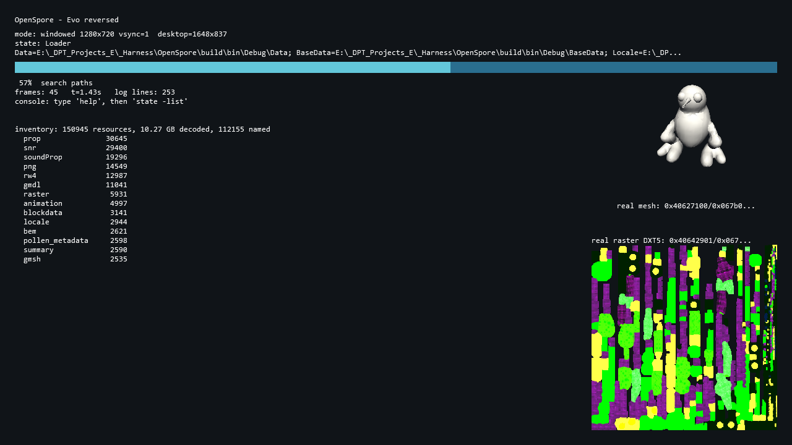

# OpenSpore

> **TL;DR (RU):** Реверс-реимплемент Spore: Galactic Adventures (x86, Windows) по документации
> в `.md` и по дизассемблеру оригинального бинарника. Сейчас это **Proof of Concept, который
> уже читает и РИСУЕТ настоящие данные игры**: грузится окно с иконкой, рендерится Loader-состояние,
> вскрываются **все 57 реальных `.package`** (≈5.7 ГБ данных EA) без единого отказа, а на своём
> D3D9-рендере выводятся **настоящая 3D-модель Spore** (`gmdl`, позиции сходятся с bbox файла точно)
> и **собственный формат текстур движка** (`raster`: DXT1/DXT5/raw). Движок (RenderWare/`rw4`) ещё
> не тронут. Дальше — по документам.

A from-scratch reimplementation of **Spore: Galactic Adventures**, driven by disassembly of
the shipped 32-bit binary rather than by wiki knowledge.



That screenshot is not a mock-up: it is an in-engine capture of our own exe. The left side is the
game's own inventory (**150,945 resources across 57 packages, 10.27 GB decoded, 112,155 names
resolved**) read through the reversed index, RefPack and FNV-1 hashing. On the right, our renderer
draws **real Spore content decoded from the shipped `.package` files**: a **`gmdl` mesh** (a
creature, 3,765 vertices / 6,000 triangles, shaded and rotating) and the engine's **own `raster`
texture format** (here a 512×512 DXT5). Earlier captures: `analysis/shots/mesh_engine.png`
(with a `.png` texture) and `analysis/shots/hero_real_asset.png`.

## Status

| | |
|---|---|
| Builds | MSVC x86 Debug, 0 errors, 0 warnings |
| Boots | **10/10** boot-chain markers with `-w -devDirs` |
| Renders | D3D9 window + icon + font atlas + Loader state, **33 fps**, machine-captured |
| Reads EA's data | **57/57 `.package` opened, 0 rejected**; 150,945 resources, 10.27 GB, 0 invariant violations |
| Decodes EA's data | **RefPack solved**: 30,000/30,000 real records decode to exactly `memSize` |
| Names EA's data | **112,155 / 150,945 resource names resolved** (type + group + instance) |
| Writes EA's data | **unpacker**: 2,944 locale + 14,549 png files written under real names, 0 failed; solved formats export as **BMP/OBJ** (whole game: 5,747 textures + 6,979 models, 0 failed) |
| **Renders EA's data** | a real decoded `.png` **and a real decoded `gmdl` mesh** (creature, 3,765 verts) **and the engine's own `raster` texture format** (DXT1/DXT5/raw) drawn on our own D3D9 renderer (see the screenshot) |
| `gmdl` (meshes) | **solved** — variable stride (vertex_bytes/count; N=3/4/6 -> 24/28/36), position = first float3; **55% of the game parses** (bbox-validated) |
| **Model + texture** | a model's texture is the `raster` with the **same instance id** (865/865 match); the engine draws a 2x2 grid of four real models, each textured |
| **Textured model** | the engine draws a real `gmdl` mesh **with its real `raster` texture** (UVs + MODULATE) |
| `rw4` (models) | header pinned down; object table not reversed (12,987 resources) |
| First real content | Czech name/place lexicon, decoded end-to-end (`LexiconPlanets_CS.trigger`) |
| Fault tolerance | proven: 5 aborts recovered inside the frame loop, 6th in 1 s → storm exit |
| Crash diagnostics | live symbolised stacks (`file:line`) via our own dbghelp harness |
| RenderWare bridge | **not started** — this is the next big piece |

Full, current numbers: [`PROGRESS.md`](PROGRESS.md) · what is actually verified against the
binary: [`VERIFY.md`](VERIFY.md).

## How the original boots (reversed from the entry point)

Full trace with addresses and instructions: [`analysis/startup.md`](analysis/startup.md).

```
PE entry 0x011e11e1 -> CRT init -> __tmainCRTStartup 0x011e0f21
  -> WinMain 0x00f489e0 -> app_main 0x00f48810 -> run 0x00f47e90
       app_main: -multipleInstances guard (named object Global\SporeEditorOrGame)
       run:      -demo/-devDirs/-shipDirs/-baseGame/-automation/-mouse/-hostIP/-clientIP/-isHost
                 creates the AppMode/config object (0x7e8a00, vtable 0x1413b50)
                 calls its vtable: init subsystems, plugins, create device, shader config
                 creates the window (0x849b20) and the renderer
  -> MAIN LOOP 0x008482f0  (window vtable +0x84)
       PeekMessageW -> WM_QUIT check -> dispatch to window handlers
         -> TranslateMessage -> DispatchMessageW -> repeat
```

The game's AppMode starts in the state **`AppModePluginLoader`** and drives a state machine
(`app`, `quit`, `UIWorld_Loading`, `EventLoadScreenBufferPercentage`). The **mouse/input pump** is
`0x84a050` (the only `PeekMessageA` user; window vtable `+0x88`).

## Progress map


Green = reversed **and** implemented **and** verified, amber = partial, grey = not started. The
same data as a text list (with a per-feature note and status) lives in
[`analysis/features.md`](analysis/features.md). Both come from one source of truth,
`analysis/features.json`, and are regenerated by `tools/feature_map.py`, so the picture and the
list can never drift apart:

```powershell
python tools/feature_map.py        # refresh analysis/shots/reverse_map.png AND analysis/features.md
```

Add a feature (or flip a `status`) in the JSON and re-run; that is how the map grows with the
project.

### Function map (how much of the binary's CODE is reversed)

The feature map above measures the **scope we chose** (boot chain + asset formats) and is high.
The hard number is different: `tools/functions.py` counts candidate function starts in the
oracle's own `.text` and how many we have actually reversed.

| | |
|---|---|
| candidate function starts in `.text` (upper bound) | **105,239** |
| functions reversed/named | **29** |
| code coverage | **0.021%** |

Text list: [`analysis/functions.md`](analysis/functions.md). The **beta PDB is a different link**
(0/12 addresses match the GA target — `analysis/build_identity.md`), so its addresses are *not*
usable for the oracle; it can only supply names where function identity matches, which is a
separate, larger effort. That is why the denominator comes from the binary, not the PDB.

The PDB is still valuable as a **name** source — it is not stripped. `tools/pdb_symbols.py`
harvests **136,433** unique function/method name paths and groups them by subsystem, which is the
engine's own vocabulary (and what makes a disassembly readable):

| subsystem (from the PDB) | functions |
|---|---|
| `SP` (the Spore engine) | 63,246 |
| `EA` | 24,214 |
| `eastl` | 9,874 |
| `rw` (RenderWare) | 6,582 |
| `nSPCreatureAnim` | 2,423 |
| `nSPSkinner` | 1,561 |

Full breakdown: [`analysis/pdb_symbols.md`](analysis/pdb_symbols.md).

### Can we guess addresses from the PDB? Partially.

A full "PDB name → oracle address" map is **not derivable**, for three verified reasons: there is no
beta **binary** (only the PDB, so no code to fingerprint); no reference build matches the oracle (all
`Also*` have different CodeView GUIDs); and the GA build is **/GR− (RTTI off)** with almost no assert
function-name strings.

What *does* work is a **string-reference guesser**: `tools/name_guess.py` attributes each `.rdata`
string referenced by a `push imm32` / `mov r32, imm32` to its enclosing function (strict starts:
prologues + `E8` targets), then matches distinctive strings to PDB name tokens (scored by string
length, token rarity, and how many functions use the string). It yields **220 candidate
address→name guesses, 39 HIGH-confidence**:

| address | proposed name | driving string |
|---|---|---|
| `0x007f6160` | `SPUICreateAnimationTimerRamp` | `SPUICreateAnimationTimerRamp` |
| `0x0089f060` | `EA::Allocator::StackAllocatorCoreAllocate` | `StackAllocatorCoreAllocate` |
| `0x00845710` | `EA::ArgScript::cParser::CommandExists` | `commandExists` |
| `0x00a73c10` | `SP::EffectsManager` | `effectsManager` |
| `0x00ea66b0` | `SP::cPlanetModel::IsUnderWater` | `isunderwater` |
| `0x01028655` | `SP::cCreatureModeStrategy::RunCinematic` | `runcinematic` |

Every row is a **guess to check by disassembly**, not truth. Two honest limits: the guesser keys on
**self-describing** functions (registrars, `GetName`, factories), so it does *not* overlap much with
the workhorse routines we hand-reversed (byte loops, decoders); and when one string matches several
PDB names (e.g. `Refpack` → 15 `EA::Refpack::*` methods) it identifies the **family** reliably but the
specific member shown is arbitrary. Full list: [`analysis/name_guesses.md`](analysis/name_guesses.md).

## Quick start

```powershell
# 1. configure + build (x86 Debug; the icon comes from assets/OpenSpore.ico)
cmake -S . -B build -G "Visual Studio 17 2022" -A Win32 -DCMAKE_BUILD_TYPE=Debug
cmake --build build --config Debug

# 2. run it the way the reversal asks (windowed, loose dev dirs)
cd build\bin\Debug
.\OpenSpore.exe -w -devDirs

# 3. watch the log while it runs (it is opened share-readable on purpose)
$fs=[IO.File]::Open("$PWD\OpenSpore.log",'Open','Read',[IO.FileShare]::ReadWrite)
$sr=New-Object IO.StreamReader($fs); $sr.ReadToEnd(); $sr.Close(); $fs.Close()
```

Game data goes in `build/bin/Debug/Data/` (base game) and `DataEP1/` (Galactic Adventures),
exactly where the original looks for it. It is **not** in this repo — `refs/` and the assets
are gitignored; only our own evidence is committed.

The unpacker (the PROMPT.md wish) writes the game's resources out under their real names, decoded.
Solved formats come out as **standard files**: `raster` textures as `.bmp`, `gmdl` models as `.obj`
**together with their paired `.bmp` texture and a `.mtl`** (a model's texture is the `raster` with
the same instance id), so exported models open textured in any 3D tool.

```powershell
# every resource of every package, filtered by type
.\OpenSpore.exe -w -devDirs -exec pkg:-unpack,all,C:\dump,locale   # all localized text
.\OpenSpore.exe -w -devDirs -exec pkg:-unpack,all,C:\dump,png      # 14,549 real PNGs
.\OpenSpore.exe -w -devDirs -exec pkg:-unpack,all,C:\dump,raster   # textures -> BMP (DXT decoded)
.\OpenSpore.exe -w -devDirs -exec pkg:-unpack,all,C:\dump,gmdl     # models -> OBJ

# the same, with NO window and NO D3D9 device (no display / CI / a server):
.\OpenSpore.exe -headless -devDirs -exec pkg:-unpack,all,C:\dump,png -quitAfter 8
```

`-headless` (alias `-noWindow`) skips the window, the device and the font atlas but keeps everything
else (logging, the harness, the search paths, the naming registry, the console). The unpack above
produces **bit-for-bit the same output as the windowed run** (2,944 files for `locale`), so the
unpacker is usable as a standalone tool.

Unattended / scripting hooks we added for testing. Arguments use `name:arg,args` so **no shell
quoting is involved** (PowerShell mangles `"-abortNow 9"` into `"._abortNow 9\`, and a harness
must not depend on that):

```powershell
.\OpenSpore.exe -w -devDirs -exec state:-list                       # the reversed `state` verb
.\OpenSpore.exe -w -devDirs -exec pkg:-hdr,0                        # header of package #0
.\OpenSpore.exe -w -devDirs -exec pkg:-rec,0,3                      # one index record
.\OpenSpore.exe -w -devDirs -exec pkg:-dump,0,3,res0.bin            # first real EA resource (packed)
.\OpenSpore.exe -w -devDirs -exec pkg:-decode,0,2,dec.bin           # RefPack-decoded game text
.\OpenSpore.exe -w -devDirs -exec pkg:-unpack,all,C:\dump,png       # unpack 14,549 real PNGs
.\OpenSpore.exe -w -devDirs -capture out.bmp -captureAfter 20 -quitAfter 60
.\OpenSpore.exe -w -devDirs -exec _abortNow:9 -quitAfter 80         # fault-tolerance test
```

All five `pkg:` subcommands above were run in this session and their output is in `HISTORY.md`.

## What it is made of

```
source/
  main.cpp                 wWinMain -> diag::early_neutralise() -> app::run
  app.h/.cpp               the 10-step boot chain (the yardstick) + the frame loop
  common.h                 u8..u64 + FNV-1 exactly as the original computes it
  engine/log.*             share-readable file, per-call-site consolidation ledger
  engine/diag.*            non-fatal asserts, abort interception, symbolised stacks,
                           run_guarded() = the fault-tolerance primitive
  engine/cmdline.*         the reversed argument contract (devDirs/shipDirs/state/preload)
  engine/fs.*              the reversed search paths; shipDirs wins over devDirs
  engine/console.*         command registry + stdin worker (help/logLevel/echo/state/pkg/capture)
  engine/pkg.*             the DBPF reader, built only on fields proven below
  render/device.*          Direct3DCreate9 (the original's single d3d9 import) + frame capture
  render/overlay.*         GDI font atlas -> staging texture -> UpdateSurface, batched text
  states/statemgr.*        AppStateManager analog: FNV ids, no nesting, onEnter/Exit/Tick/Render
  states/loader.cpp        our Loader state; it lists the real packages on screen
tools/                     24 Python/PowerShell reversal tools (see RESUME.md)
analysis/                  generated evidence: recon, build identity, verification, screenshots
upstream/                  third-party RE knowledge we copied in, with its errors recorded
```

Everything here is ours; no EA code or asset is shipped in the repository.

## The reversal oracle (the thing that made this possible)

The retail `SporeApp.exe` ships with an **encrypted `.text`** (entropy 8.000) — it cannot be
disassembled at all. The decrypted dump `SporeApp.exe.unpacked.exe` **is** the same link:
every other section is byte-identical, and the proof is a cross-section test (the decrypted
code references 7 known `.rdata` string addresses that the encrypted original references 0/7
of), run against the encrypted `.text` as a **control**. 9/9 metrics pass.
Details: `analysis/unpacked_verification.md`.

So authority order #1 (disassembly of the original binary) is usable again, and every claim in
`VERIFY.md` carries the instructions it was based on.

## What we already know for certain

A few highlights, all with addresses in [`VERIFY.md`](VERIFY.md):

* **The game's state machine is real and reachable in the retail build** — `AppStateManager`,
  a `state` console verb with `-list^-next^-prev^-reload^`, and state identity is a
  **FNV-1 hash of the name** stored at `[state+0x28]`, with duplicate IDs rejected and
  nesting forbidden ("can't nest states or transitions"). The state *names* are `.eBT` script
  data, so until packages parse we own the mechanism and ship our own `Loader`.
* **`-devDirs` / `-shipDirs`** are looked up through one helper (`0x0092b570`); `shipDirs`
  wins, and the result is `[configObj+0x159]`. The whole launch vocabulary is enumerated
  mechanically: 76 call sites → 56 names in `analysis/arg_vocab.md`.
* **DBPF**: 0x60-byte header whose validator we replay clause-by-clause; the index's first
  dword is a **shared-field bit mask**, so `prefix = 4 + 4·popcount(K)` and
  `stride = 32 − 4·popcount(K)`; a record's last u32 is really `compression:u16 + flags:u16`,
  and splitting it explains every value ever seen (0xFFFF = RefPack in 98,407 records,
  0x0000 = raw in 52,538, with payload bytes confirming both).
* **The engine is RenderWare on D3D9, statically linked** — one single `d3d9.dll` import, so
  the RW seam is inside `.text` and the plugin-registration family is the next target.

## Method

This project follows two documents that came with it, and they are the rules, not decoration:

* [`PROMPT.md`](PROMPT.md) — what the user asked for.
* [`reimplementation-field-guide.md`](reimplementation-field-guide.md) — the playbook.
* [`ai-brief-and-commands.md`](ai-brief-and-commands.md) — the authority order and the tooling.

Non-negotiables we hold ourselves to:

1. **Disassembly is the primary tool.** We read the original's instructions before we look at
   its data files, and we quote the instructions inline in any code they justify.
2. **Every metric gets a chance baseline and a control.** Three early revisions of our own
   verifier were wrong because they had neither; that is written down in `IDEAS.md` §5 so it
   is not repeated.
3. **Nothing is stubbed unless its consumers and their guards are named.**
4. **No modal dialog may ever block the process** — asserts log and continue, `abort()` is
   intercepted and recovered from, and the crash harness is installed before anything that
   could need it.
5. **Disproven hypotheses are recorded, with evidence**, because losing one costs a week.

## Documentation map

| file | what it answers |
|---|---|
| [`RESUME.md`](RESUME.md) | start here: current state, exact commands, next actions |
| [`PROGRESS.md`](PROGRESS.md) | the boot/load chain, one row per step, ✅/🚧/❌ |
| [`VERIFY.md`](VERIFY.md) | feature × address × disasm-status, plus the ordered next actions |
| [`MEMORY.md`](MEMORY.md) | durable facts: layouts, the DBPF format, and every trap we hit |
| [`IDEAS.md`](IDEAS.md) | deferred work, open questions, and ⚠️ things we disproved |
| [`HISTORY.md`](HISTORY.md) | what changed each session **and how it was verified** |

## Honest limits

* **No RenderWare, no meshes yet.** We can open, index and **decompress** any resource, but we
  have not decoded a mesh, a texture or a behaviour tree. The `rw4` type (0x2F4E681B, 12,987
  records) is the RenderWare container and is the next target. The Loader screen is our own art.
* **RefPack is solved and verified** (30,000/30,000 real records decode to exactly `memSize`,
  `tools/refpack.py --verify`), and `pkg:-decode` writes real game data. The first decoded
  assets are the Czech name/place lexicon.
* **`-w` is our own convention.** It is *not* in the original's argument vocabulary; we say so
  instead of pretending we reversed it (`VERIFY.md` row 15).
* **x64 exists only as a CMake switch** and has never been compiled.
* Third-party RE knowledge (`upstream/SporeMaster3/`) was **tested before being used**, and it
  was wrong in **three** places now (RefPack endianness, "type id = FNV(name)", and its prose
  generally - though its *source code* was accurate where the summary was not). All recorded in
  `MEMORY.md` and `IDEAS.md` §5 rather than quietly adopted.

## Licence / provenance

Reimplementation for study. No EA code, binaries or assets are distributed here — `refs/`
(reference binaries) and the game data are gitignored by design. The icon in
`assets/OpenSpore.ico` is the user's own artwork for this project.
