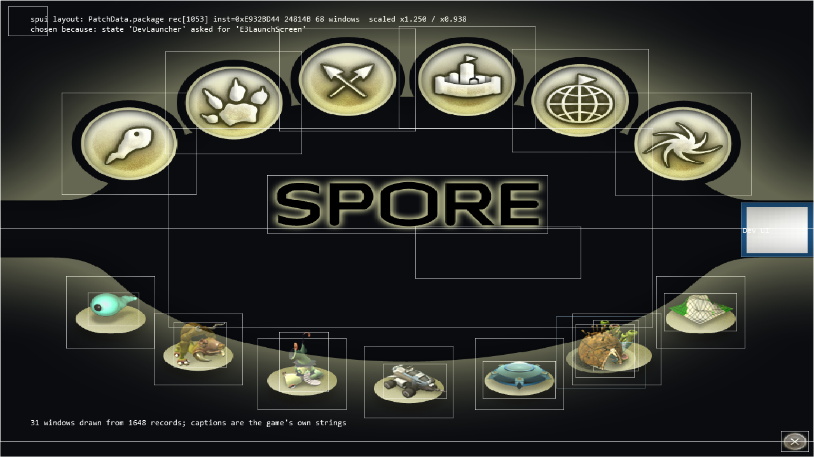
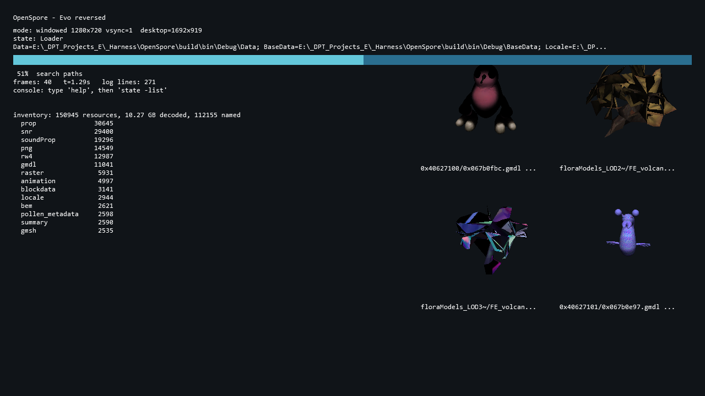

# OpenSpore

### Spore: Galactic Adventures — от бинарника к самостоятельной игре

**Windows · x86 · Debug · C++20 · Direct3D 9 · CMake / MSVC**

OpenSpore — самостоятельная реимплементация **Spore: Galactic Adventures** на основе
дизассемблирования GA-бинарника и проверки shipped data. Цель — восстановить путь от `Main`
до полностью играбельной игры, а не только открыть её ресурсы.

> **Сейчас:** приложение загружается, читает игровые пакеты, показывает настоящий launcher
> из SPUI и атласов, обрабатывает выбор видимой плитки и переходит в нужное состояние.
> **Но:** редакторы и игровые стадии ещё не работают. Это исследовательская сборка, не замена Spore.
>
> Последняя сверка: **15 октября 2026**. [Текущий статус](PROGRESS.md) ·
> [Чеклист функций](analysis/features.md) · [Доказательства](VERIFY.md) · [План продолжения](RESUME.md)

## Уже не просто прямоугольники



Это **capture нашего `OpenSpore.exe`**, а не макет и не окно оригинальной игры.
Экран выбирается командой `uilayout -load E3LaunchScreen` из игрового состояния `DevLauncher`.
Рендерер использует реальную иерархию окон, UV-области атласов и кадры состояний кнопок.
Светлые рамки и диагностические подписи пока намеренно оставлены.

**Проверенная цепочка:**

```text
boot → DevLauncher → E3LaunchScreen → видимая плитка → CreatureEditor
                                                       └─ состояние есть; редактор ещё не реализован
```

Детали и GA-адреса: [SPUI binary](analysis/spui-binary.md) · [drawables](analysis/spui-drawables.md).

Следующий участок Main-пути тоже подключён: `Main → GalaxyGameEntry` показывает подтверждённый
GA-кодом primary layout `GlobalUIGGE-9`. Это пока **почти пустой диагностический UI без галактики**,
zoom-панелей и runtime-контроллера, не готовый экран выбора игры.
[Разбор и ограничения](analysis/galaxy-entry.md) · [capture](analysis/shots/gge_primary_ui.png).
Разобран также [Intro handler](analysis/gge-intro.md): C++-модель post-title gate проверяет
условия MoviePlayer/DBCheck. В runtime пока нет этих сервисов, поэтому показано явное ожидание,
а не фиктивная готовность галактики.

## Что работает — и где граница

| Область | Реализовано и проверено | Ещё не готово |
|---|---|---|
| Запуск | x86 Debug, окно, консоль/лог, **10/10** boot markers, capture и fault-tolerance harness | x64 и выпуск для обычных игроков |
| Пакеты | **57/57 DBPF**, **150 945** записей; RefPack; CLI-распаковка; вложенные пакеты | запись/repack, полная оригинальная приоритизация ресурсов |
| SPUI | **748/748** файлов до EOF, **93 726** объектов, **22 384** окна, **20 659** связей Children; общий ancestor Clip для picking/render | WinProcs, динамическая раскладка/Z-порядок, общий command dispatcher |
| UI art | UV и логические размеры Image; None-tiling ImageDrawable; нетайловые Standard/Radio; scale/alignment | tiling, outline/shadow, Dialog pieces и полный event lifecycle кнопок |
| Текст | locale-таблицы, в том числе вложенные; **1 384 / 1 426** caption refs разрешаются | оригинальный шрифтовой renderer, полный Unicode/layout |
| Модели | поддерживаемый subset `gmdl`, UV, `raster` DXT1/DXT5/raw; галерея настоящих моделей | полноценные RW4, материалы, анимация и игровой мир |
| Навигация | видимый клик `(311,550)` → `CreatureEditor [0x022D9E01]` | сам Creature Editor и playable stages |

<details>
<summary><strong>Ранее достигнуто: модели и их текстуры</strong></summary>



Это отдельная диагностическая галерея. Она подтверждает чтение и отрисовку поддерживаемых ассетов,
**не** игровую симуляцию или полноту `gmdl`/RenderWare. Подробности: [форматы](analysis/formats.md).

</details>

## Прогресс без «игра готова на 80%»


Каждая клетка — **один пункт нашего чеклиста**, а не функция бинарника и не одинаковый объём работы.
Открытое поле заголовка, готовый диагностический инструмент и игровая стадия имеют разную сложность.
Навигация UI отделена от gameplay: переход в редактор не делает редактор готовым.

В [полном списке](analysis/features.md) есть статусы, границы и ссылки на evidence.
Взвешенный индекс `(done + 0.5 × partial) / total` — лишь вспомогательная метрика чеклиста,
**не процент готовности игры, покрытия кода или оценка оставшегося времени**.

```powershell
python tools/feature_map.py          # PNG + Markdown + machine-readable stats
python tools/feature_map.py --check  # проверка актуальности без перезаписи
```

Источник: [`analysis/features.json`](analysis/features.json). Результаты:
[`features.md`](analysis/features.md), [`features_stats.json`](analysis/features_stats.json), PNG выше.
Дата на картинке — дата сверки исходного списка, а не просто дата запуска скрипта.

## Сборка и запуск

### Нужно

- Windows и Visual Studio 2022 / Build Tools с **Desktop development with C++** и Windows SDK.
- CMake 3.25+, генератор **Win32**, конфигурация **Debug**.
- Собственные легально полученные данные Spore + Galactic Adventures. Бинарники и `.package`
  в Git не включены; `.exe` оригинала нужен для исследования, а не для запуска нашей программы.
- Python 3.11+ для исследовательских инструментов; **Pillow** для прогресс-картинки.
  Сама C++-сборка Python не требует.

```powershell
# Из корня репозитория
cmake -S . -B build -G "Visual Studio 17 2022" -A Win32 -DCMAKE_BUILD_TYPE=Debug
cmake --build build --config Debug --target OpenSpore spui_verify pkg_lifetime_verify overlay_clip_verify mode_ui_verify gge_intro_verify gge_dbcheck_verify gge_catalog_verify starsdb_verify starsdb_inspect starsdb_links_verify starsdb_context_verify starsdb_context_inspect starsdb_dbpf_verify starsdb_dbpf_inspect starsdb_postload_verify save_header_verify save_header_inspect planet_record_verify planet_record_inspect gge_star_present_verify gge_star_instance_verify gge_star_phase1_verify gge_image_verify gge_animated_verify gge_star_lifecycle_verify gge_streaming_image_verify gge_star_scene_verify gge_star_transition_verify
```

Расположение данных рядом с собранным executable:

```text
build/bin/Debug/
  OpenSpore.exe
  Data/                 # базовые .package, Locale/<lang>/, Config/
  DataEP1/              # пакеты и Config Galactic Adventures
  UserData/             # создаётся приложением
```

Данные нужны в их собственной структуре; **не** переименовывайте `.package` в `.package.big`.
Числа в тестах относятся к конкретному проверенному набору из 57 пакетов, а не к любой установке.

```powershell
cd build/bin/Debug

# Настоящий launcher; закройте окно вручную
.\OpenSpore.exe -w -devDirs -state:DevLauncher

# Короткий unattended-прогон со screenshot
.\OpenSpore.exe -w -devDirs -state:DevLauncher -quitAfter 30 -capture launcher.bmp -captureAfter 20

# Регрессия видимого перехода; редактор после перехода пока не работает
.\OpenSpore.exe -w -devDirs -state:DevLauncher -quitAfter 18 -exec spui:-click,311,550

# Main -> GalaxyGameEntry: только подтверждённый primary UI subset, без симуляции галактики
.\OpenSpore.exe -w -devDirs -state:Main -quitAfter 30 -capture gge.bmp -captureAfter 20
```

`-quitAfter` задаётся **в кадрах**, не секундах. Для автоматических запусков задавайте его явно.
Лог — `build/bin/Debug/OpenSpore.log`, открыт для параллельного чтения и дописывается между запусками.

### Проверки

Из корня репозитория:

```powershell
$fixtures = Join-Path $env:TEMP 'OpenSpore-spui-fixtures'
python tools/spui_objects.py --parse --all --output analysis/audit/spui_objects.json --extract $fixtures
.\build\Debug\spui_verify.exe $fixtures
.\build\Debug\mode_ui_verify.exe
.\build\Debug\gge_intro_verify.exe
.\build\Debug\gge_dbcheck_verify.exe $fixtures
.\build\Debug\gge_catalog_verify.exe
.\build\Debug\starsdb_verify.exe
.\build\Debug\starsdb_links_verify.exe
.\build\Debug\starsdb_context_verify.exe
.\build\Debug\starsdb_dbpf_verify.exe
.\build\Debug\starsdb_postload_verify.exe
.\build\Debug\save_header_verify.exe
.\build\Debug\planet_record_verify.exe
.\build\Debug\gge_star_present_verify.exe $fixtures
.\build\Debug\gge_star_instance_verify.exe $fixtures
.\build\Debug\gge_star_phase1_verify.exe $fixtures
$imageCapture = Join-Path $env:TEMP ('OpenSpore-image-' + [guid]::NewGuid() + '.bmp')
.\build\Debug\gge_image_verify.exe $fixtures .\build\bin\Debug\Data\PatchData.package $imageCapture
$frameCapture = Join-Path $env:TEMP ('OpenSpore-frame-' + [guid]::NewGuid() + '.bmp')
.\build\Debug\gge_animated_verify.exe $fixtures .\build\bin\Debug\Data\Spore_Graphics.package $frameCapture
.\build\Debug\gge_star_lifecycle_verify.exe $fixtures .\build\bin\Debug\Data\PatchData.package .\build\bin\Debug\Data\Spore_Graphics.package
$streamDir = Join-Path $env:TEMP ('OpenSpore-stream-' + [guid]::NewGuid())
.\build\Debug\gge_streaming_image_verify.exe .\build\bin\Debug\Data\Spore_Graphics.package $streamDir
.\build\Debug\gge_star_scene_verify.exe $fixtures .\build\bin\Debug\Data\Spore_Graphics.package
.\build\Debug\gge_star_transition_verify.exe $fixtures
.\build\Debug\pkg_lifetime_verify.exe .\build\bin\Debug\Data\Locale\en-us\UI.package
$clipCapture = Join-Path $env:TEMP ('OpenSpore-scissor-' + [guid]::NewGuid() + '.bmp')
.\build\Debug\overlay_clip_verify.exe $clipCapture
python tools/pkg_kinds.py
python -m unittest discover -s tools/tests -p 'test_*.py'
python tools/feature_map.py --check
python tools/docs_check.py
```

Последняя проверка: **748** corpus matches, **486** malformed inputs rejected атомарно,
drawable UV/state/scale/alignment и ancestor Clip checks PASS; **544** scoped package cycles при CRT-лимите **512**.
Отдельный D3D9 readback проверяет реальные пиксели flat/image quad, text flush и scissor reset.
Post-title gate GGE проходит **2040** проверок на контролируемых сигналах; это не наблюдение
оригинальной игры и не реализация MoviePlayer/DBCheck.
`gge_dbcheck_verify` отдельно проверяет DBCheck-поднабор через явный backend и реальный fixture
диалога: ветки отсутствующего/неизвестного manager, callback-порядок, cleanup и связку с Intro.
Live backend ещё не подключён; [state 2 Play Spore](analysis/gge-dbcheck-play.md) требует настоящего
каталога игр, per-star UI и сцены, а не принудительного раскрытия скрытых панелей.
Добавлена [сборка записей каталога](analysis/gge-catalog.md) из типизированных метаданных: порядок,
индексы, позиции, стадии, image fallback и сравнение двух полей заголовка сохранения. Проверена на контролируемых входах;
producer каталога и live-галактика ещё не реализованы. Для [сериализатора `stars.db`](analysis/starsdb.md)
добавлен read-only инспектор префикса и caller-selected wire subset: framing, шесть полей метаданных,
ссылки/ячейки и 14 полей StarRecord. [Контекст объектов](analysis/starsdb-context.md) теперь читает
индекс и class stream, проверяет envelope CRC и связывает `(class_id, token)` с записью.
Read-only [DBPF-адаптер](analysis/starsdb-dbpf.md) подключает эти readers к точным root/index/class keys.
**240 + 362 + 126 + 266** синтетических проверок проходят; post-load fixups и live producer
не подключены, настоящие сохранения этим тестом не проверены.
Отдельно [save-header reader](analysis/save-header.md) читает настоящие по схеме GA поля
`mFileVersionMajor/Minor` из явно выбранного DBPF: **116** контролируемых проверок, без поиска сохранений.
Post-load модель исправлена: **15** проверок ветки пустого имени / маркера `BAD_DATA`; прежнее
описание «canonical-name mismatch cleanup» было ошибочным. Генератор и сервисы пока не выполняются.
[Planet-record reader и saved adapter](analysis/planet-record.md) связывают имя выбранной планеты,
поля звезды и header/terrain-наблюдения с типизированной GGE-записью: **291** контролируемая проверка.
Это ещё не галактика на экране: camera/effects/per-star UI и реальные источники не подключены.
[Визуальный участок GGE](analysis/gge-star-present.md) теперь включает расчёт проекции, размещение
и stage-конфигурацию UI каждой звезды: **50** проверок, два настоящих layout по **152 объекта / 58 окон**.
Создание камеры и монтаж этих экземпляров в runtime ещё отсутствуют; видимый GGE пока не изменён.
Добавлен [host-слой независимых star UI instances](analysis/gge-star-instance.md): **167** проверок
владения, перемещения, флагов, caption refs и pixel picking. Общий renderer теперь имеет pixel-layer hook;
native plugins/callbacks/сцена и автоматическое подключение к GGE всё ещё не реализованы.
[Phase-1 binding plan](analysis/gge-star-phase1.md) добавляет **247** проверок порядка и веток привязки
изображений/controls, не исполняя сервисы. Поиск уникального target или наличие resource key не
считается успешной загрузкой; видимый экран пока не изменён.
Следующий [image-путь](analysis/gge-image-bindings.md) уже применяет реально декодированный PNG к
ImageDrawable host-экземпляра: **80** проверок, сохранение atlas UV/размеров, изоляция экземпляров
и контролируемый D3D9 pixel-readback. Animated Icon и вся GGE-сцена этим не реализованы.
Отдельный [статический Animated Icon selector](analysis/gge-animated-icon.md) теперь добавляет
**159** проверок: выбор кадра в atlas, отдельное состояние окон и контролируемый multi-row GPU test.
Auto Play/native-нормализация/полная GGE-сцена остаются вне этого шага.
Новый [host lifecycle](analysis/gge-star-lifecycle.md) объединяет эти операции: **232** проверки
владения, повторных попыток, stale tickets, отдельных action statuses, UTF-имени и центрирования.
Его независимые host-действия не означают завершение native phase-1; автоматического GGE caller пока нет.
Теперь [streaming provider](analysis/gge-streaming-images.md) подаёт atlas прямо из большого оригинального
`Spore_Graphics.package`, без тестового DBPF-carrier: **95** проверок, bounded index/resource reads и
64-битные смещения (проверены sparse data/index выше 2 ГиБ). Старый memory-adapter лимиты не меняет.
Добавлен [host scene collector](analysis/gge-star-scene.md): **204** проверки явного Available-каталога,
active-camera observation, размещения/layer views и picking. Потеря камеры/каталога отключает старые
draw/pick frames; native factories/effects/видимая галактика и автоматический GGE caller не реализованы.
Восстановлен [explicit show/phase subset](analysis/gge-star-transition.md): **195** проверок cases2..5
с отдельным current-phase observation. Case2 делает настоящую панель hittable без снятия root IgnoreMouse;
case4 не записывает native latch даже при return1. Сервисы/input dispatch/latch и GGE runtime не подменяются.
Это разные проверки: parser correctness не доказывает полноту UI/gameplay.

### Полезный CLI

Из `build/bin/Debug`:

```powershell
.\OpenSpore.exe -headless -devDirs -quitAfter 8 -exec state:-list
.\OpenSpore.exe -headless -devDirs -quitAfter 8 -exec pkg:-unpack,all,C:\SporeDump,png
.\OpenSpore.exe -headless -devDirs -quitAfter 8 -exec pkg:-unpack,all,C:\SporeDump,raster
.\OpenSpore.exe -headless -devDirs -quitAfter 8 -exec pkg:-unpack,all,C:\SporeDump,gmdl
```

Поддерживаемые raster экспортируются в BMP, gmdl — в OBJ с парной текстурой/MTL;
неподдерживаемые варианты не становятся автоматически пригодными моделями. `-headless` не создаёт
окно и D3D-устройство. Путь вывода выбирайте самостоятельно: распаковка может занимать много места.

## Как ведётся реверс

1. **Адресный oracle — только GA-unpacked:** `refs/bins/ReleaseGA/SporeApp.exe.unpacked.exe`.
2. Инструкции/декомпиляция → проверка shipped data → ограниченная реализация → тест/capture.
3. Persistent Ghidra и REA используются для binary evidence; результаты сохраняются в `analysis/audit/`.
4. Beta EXE/PDB — семантический ориентир, **не источник GA-адресов**.
5. Наблюдения, гипотезы и наши presentation policies обозначаются отдельно.

Необходимые инструкции: [исходный brief](PROMPT.md), [field guide](reimplementation-field-guide.md),
[toolchain](analysis/toolchain-rea.md). Границы регистра функций объяснены в
[functions.md](analysis/functions.md): ручной каталог **не является** полной оценкой покрытия бинарника.

## Документация и следующий шаг

| Документ | Для чего |
|---|---|
| [PROGRESS.md](PROGRESS.md) | текущие возможности, ограничения и повторяемые проверки |
| [RESUME.md](RESUME.md) | короткий hand-off и ближайшие задачи |
| [VERIFY.md](VERIFY.md) | evidence ledger: адреса, тип доказательства, опровержения |
| [analysis/README.md](analysis/README.md) | навигация по исследованиям, генераторам и архивам |
| [MEMORY.md](MEMORY.md) | устойчивые выводы и ловушки; старые секции явно исторические |
| [IDEAS.md](IDEAS.md) | roadmap, отложенные идеи и опровергнутые гипотезы |
| [HISTORY.md](HISTORY.md) | хронология: что проверялось в тот момент, не текущий статус |

Renderer clipping уже согласован с hit testing в текущей presentation policy. Ближайший путь:
недостающие drawable/event ветки, затем `GalaxyGameEntry` и поведение `AppMode`.
Подробный план — в [RESUME.md](RESUME.md).

## Происхождение материалов

Исследовательский проект, не связанный с EA/Maxis и не одобренный ими. Оригинальные executable,
PDB и игровые пакеты не включены в репозиторий. В документации есть captures с игровым artwork и
статические фрагменты анализа; это не утверждение о владении контентом EA и не лицензия на него.
Иконка `assets/OpenSpore.ico` — предоставленная пользователем работа для проекта.
